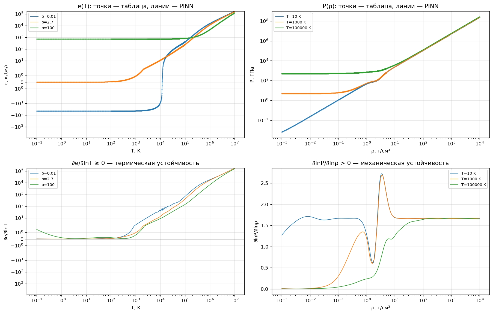

# PINN для уравнения состояния алюминия

[](https://colab.research.google.com/github/Antibote/pinn-eos-aluminum/blob/main/notebooks/pinn_eos_colab.ipynb)

Кейс 02 (Machine Learning) хакатона «ИТ КоР 5.0» (Росатом) — **нейросетевая аппроксимация широкодиапазонного уравнения состояния (УРС) алюминия с учётом термодинамических ограничений**.

Физически-информированная нейросеть (PINN) по плотности ρ и температуре T выдаёт давление P(ρ, T) и удельную внутреннюю энергию e(ρ, T), считает их частные производные и скорость звука c_s и при этом соблюдает условия термодинамической устойчивости во всей области ρ = 10⁻³–10⁴ г/см³, T = 0,1–10⁷ К.

## Главное

| Модель | Ошибка P, медиана / p99 | Ошибка e, медиана / p99 | ∂P/∂ρ ≤ 0 | ∂e/∂T < 0 | 0 < c_s < c нарушено | Размер | 10⁵ запросов |
|---|---|---|---|---|---|---|---|
| Baseline (билинейная интерполяция) | 0,00045% / 0,044% | 0,004% / 0,17% | 0,047% | 0,46% | 0,79% | 34,5 МБ | 0,067 с (CPU) |
| Vanilla MLP 256×4 | 1,03% / 9,8% | 1,16% / 27,8% | 4,84% | 10,69% | — | 0,76 МБ | 0,023 с (GPU) |
| **PINN 256×4** | **0,23% / 2,6%** | **0,25% / 3,2%** | **0%** | **0%** | **0%** | 0,76 МБ | 0,013–0,023 с (GPU) |
| **PINN, веса float16** | 0,23% / 2,6% | 0,25% / 3,2% | 0% | 0% | 0% | **0,38 МБ** | — |
| PINN, SVD r = 64 + дообучение | 0,33% / 2,5% | 0,40% / 3,4% | 0% | 0% | 0% | 0,20 МБ | 0,016 с (GPU) |

Все модели проверены одной функцией (`eos.metrics.evaluate`) на одном test — 674 826 узлах таблицы, не участвовавших в обучении. Ошибка P — |ΔP|/P, ошибка e — |Δe|/max(|e|, 1 кДж/г); нарушения — доля точек, где знак производной (конечные разности) противоречит условию. Полная таблица — [`artifacts/metrics_final.md`](artifacts/metrics_final.md).

- **PINN в 4,5 раза точнее Vanilla** и не нарушает ни механической, ни тепловой устойчивости, ни ограничения 0 < c_s < c — ни на test, ни в 10⁵ случайных точках всей области (проверка через autograd).
- **Бейзлайн точнее по значениям, но хранит всю таблицу** (34,5 МБ при лимите 10 МБ) и сам нарушает физику на стыках ячеек. PINN с весами float16 — в 90 раз меньше.
- **Исходная таблица термодинамически несогласована**: в холодной плотной части ρ²(∂e/∂ρ)_T ровно в 2 раза меньше P − T(∂P/∂T)_ρ (`artifacts/table_consistency.csv`). Поэтому согласованность не штрафуется, а только контролируется.
- **Сжатие без потери физики**: SVD внутренних слоёв (r = 64) с коротким дообучением на физических штрафах уменьшает модель вдвое (0,20 МБ) при ошибке 0,33% и нулевых нарушениях; без дообучения тот же SVD даёт 17,7% ошибки и 11,6% нарушений.
- **Инференс на C** (`csrc/eos_pinn.c`) для встраивания в расчётные коды: один запрос — 15 мкс (7,3 мкс для SVD r = 64) против 114 мкс у PyTorch и 30 мкс у ONNX Runtime, без Python и PyTorch; точность совпадает до 6·10⁻⁶.
- При сильном сжатии сеть сама восстанавливает закон P ∝ ρ^5/3 (вырожденный электронный газ): ∂lnP/∂lnρ → 5/3.



## Быстрый старт

```bash
git clone https://github.com/Antibote/pinn-eos-aluminum.git
cd pinn-eos-aluminum
pip install -e .            # пакет eos и зависимости; для ноутбуков и тестов: pip install -e ".[dev]"

python run.py                              # P, e, c_s и проверка физики на характерных точках
python run.py --rho 2.7 10 --T 300 1e4     # свои точки
python run.py --benchmark                  # время на 10^5 случайных запросов
python run.py --evaluate                   # метрики на test (данные скачаются в data/)
python -m pytest                           # тесты
gcc -O3 -march=native -ffast-math -fopenmp csrc/example.c csrc/eos_pinn.c -o example -lm   # инференс на C
```

```python
from eos import EOSModel

model = EOSModel("artifacts/pinn.pt", "artifacts/normalization.json")  # device="cuda" — на GPU
P, e = model.predict(rho, T)          # ГПа, кДж/г; rho в г/см³, T в K — числа или массивы
d = model.derivatives(rho, T)         # dP_drho, dP_dT, de_drho, de_dT (autograd, float64)
cs = model.sound_speed(rho, T)        # км/с
flags = model.check_physics(rho, T)   # mechanical, thermal, sound, consistent, in_domain
```

Без кода проекта: `torch.jit.load("artifacts/pinn_torchscript.pt")(rho, T)` или ONNX Runtime с `artifacts/pinn.onnx` (входы `rho`, `T` — float32, выходы `P`, `e`).

## Ноутбуки (Google Colab, GPU T4)

| Ноутбук | Что внутри |
|---|---|
| [`notebooks/pinn_eos_colab.ipynb`](notebooks/pinn_eos_colab.ipynb) | **Общий ноутбук команды с результатами**: разделы 0–5 |
| [`notebooks/section3_pinn.ipynb`](notebooks/section3_pinn.ipynb) | раздел 3 отдельно: функция потерь, обучение PINN, скорость звука, сравнение |
| [`notebooks/section4_inference.ipynb`](notebooks/section4_inference.ipynb) | раздел 4: `EOSModel`, скорость, экспорт, сжатие, итоговая таблица |
| [`notebooks/section5_optimization.ipynb`](notebooks/section5_optimization.ipynb) | раздел 5: дистилляция, float16, ONNX, смешанная точность |

Порядок: `Среда выполнения → T4 GPU`, затем раздел 0 (клонирует репозиторий и скачивает данные), затем нужные разделы. Ячейки `notebooks/sectionN/cell_*.py` можно запускать в любом ноутбуке строкой `%run -i pinn-eos-aluminum/notebooks/sectionN/cell_N_M.py`.

**Токен GitHub для ноутбука не нужен**: код и данные только читаются (репозиторий открытый). Секрет Colab `GITHUB_TOKEN` нужен лишь чтобы `save_to_repo` отправляла новые результаты в `artifacts/`; без него ячейки работают, а результаты остаются в среде Colab.

## Данные

Публичная папка организаторов: https://disk.yandex.ru/d/iUSbYrJcsbXSbw — `eos.data.download()` (её вызывает `run.py --evaluate`) скачивает `Obl01–Obl20.txt` в `data/` (в git не попадают).

- 20 областей = 4 диапазона ρ × 5 диапазонов T, 1 130 053 точки; каждая область — полная прямоугольная сетка (log-log — 12 областей, lin-log — 4, log-lin — 3, lin-lin — 1); диапазоны полуоткрытые `[min, max)`, повторов между областями нет.
- Колонки `rho [g/cm^3], T [K], P [GPa], e [kJ/g]`; P ∈ [5·10⁻⁴; 1,6·10⁹] ГПа (всегда > 0), e ∈ [−46,8; 1,68·10⁵] кДж/г (19,4% отрицательных).
- Особенности: плато энергии при T ≲ 7 К (∂e/∂T = 0), шов при T ≈ 142 К (давление скачком падает до ~30%), 345 выбросов в Obl04.

## Метод

1. **Нормировка** (`EOSNormalizer`, sklearn): log10 ρ, log10 T → `MinMaxScaler(-1, 1)`; log10 P и asinh(e / 1 кДж/г) → `RobustScaler`. Нормировка встроена в сеть, поэтому autograd сразу даёт производные в физических единицах.
2. **Разбиение** (seed 0): train — каждый второй узел сетки по ρ и T (25%), остальные узлы — val 20% / test 80%. Бейзлайн строится на тех же train-узлах. Веса точек выравнивают сгущение линейных сеток.
3. **Baseline** — билинейная интерполяция по каждой области в координатах (log10 T, log10 ρ).
4. **Vanilla** — MLP 2 → 256×4 → 2 (SiLU), взвешенная MSE, AdamW.
5. **PINN** — та же размерность, активация GELU, функция потерь

   L = L_data + λ_ρ·mean max(0, −∂lnP/∂lnρ) + λ_T·mean max(0, −∂e/∂lnT)/(|e|+1) + λ_c·L_c,

   где L_c — нарушение 0 < c_s < c, c_s² = (∂P/∂ρ)_T + T(∂P/∂T)²_ρ / (ρ²(∂e/∂T)_ρ). Производные — autograd по ln ρ, ln T; штрафы — в 1024 случайных точках всей области на каждом шаге; λ = 1 с разогревом. Неравенство для c_s записано без деления на ∂e/∂T, иначе обучение расходится на плато таблицы. Выбор активации, функции потерь и способа объединения градиентов (fixed / adaptive / PCGrad) — поэтапным поиском (`eos.pinn.search`).
6. **Инференс и сжатие** — `EOSModel`, экспорт TorchScript/ONNX, float16 (без потерь), int8 (непригодно), SVD-сжатие внутренних слоёв 256→256 + дообучение 1000 шагов с физическими штрафами: при r = 64 вдвое меньше (0,20 МБ) при ошибке 0,33% и без нарушений; дистилляция в 128×4 и 64×4: 64×4 в 27 раз меньше и в 9,9 раза быстрее на CPU (подробности — [`docs/README_Module5.md`](docs/README_Module5.md)).

Подробно по модулям: [`docs/README_Module1.md`](docs/README_Module1.md) … [`docs/README_Module5.md`](docs/README_Module5.md).

## Структура

```
run.py                 точка входа: демонстрация, свои точки, скорость, метрики на test
src/eos/
  data.py              загрузка таблиц, region_grid, download()
  eda.py               проверка структуры, аномалии, стыки областей
  normalize.py         EOSNormalizer (sklearn): нормировка входов и выходов
  baseline.py          билинейная интерполяция, бенчмарк
  model.py             EOSNet (нормировка внутри), разбиение, веса точек, производные
  metrics.py           общие метрики: ошибки и нарушения физики
  pinn.py              физические штрафы, обучение (+ дистилляция), поиск гиперпараметров
  inference.py         EOSModel, экспорт TorchScript/ONNX, сжатие
  cinfer.py            экспорт весов для C, сборка и обёртка библиотеки csrc/eos_pinn.c
csrc/                  инференс на C: eos_pinn.c/.h (прямой проход), example.c (вызов из расчётного кода)
notebooks/             ноутбуки Colab и ячейки разделов 3–5 (cell_*.py), save_to_repo.py
artifacts/             модели, нормировка, разбиение, метрики, графики — см. artifacts/README.md
docs/                  README_Module1–5.md, Документация.docx, Инструкция для проверяющих.docx
tests/                 pytest: нормировка, модель, физика, экспорт, разбиение
data/                  таблицы Obl01–Obl20 (не в git)
```

## Команда «Филиал МГУ в городе Сарове»

| Участник | Модуль |
|---|---|
| Деревянкин Кирилл (@KDerevyankin) | 1. Данные, EDA и бейзлайн |
| Елагин Матвей (@Tony11Montana), капитан | 2. Vanilla MLP |
| Королева Ульяна (@UlyaSKoroleva) | 3. PINN и физические ограничения |
| Володченко Александра (@alexachenko) | 4. Инференс, упаковка и сжатие |
| Селивохин Ярослав (@Antibote) | 5. Сжатие и скорость, документация и презентация |

## Чек-лист сдачи

- [x] Код всех модулей (`src/eos/`, ноутбуки)
- [x] Обученная модель ≤ 10 МБ: `artifacts/pinn.pt` (0,76 МБ), `pinn_fp16.pt` (0,38 МБ), `pinn.onnx`
- [x] Файл нормализации: `artifacts/normalization.json`
- [x] README.md с инструкцией по запуску
- [x] README_ModuleN.md для каждого модуля (`docs/`)
- [x] Docstrings у публичных функций и классов
- [x] Итоговые визуализации (`artifacts/figures/`)
- [x] Таблица сравнения baseline / Vanilla / PINN (`artifacts/metrics_final.md`)
- [x] Документация: `docs/Документация.docx`, инструкция для проверяющих — `docs/Инструкция для проверяющих.docx`
- [ ] Презентация
